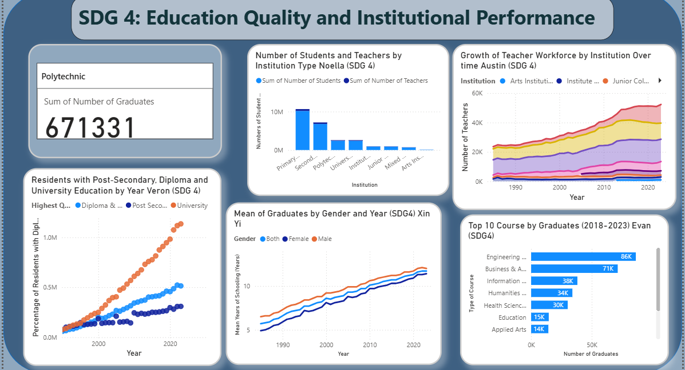
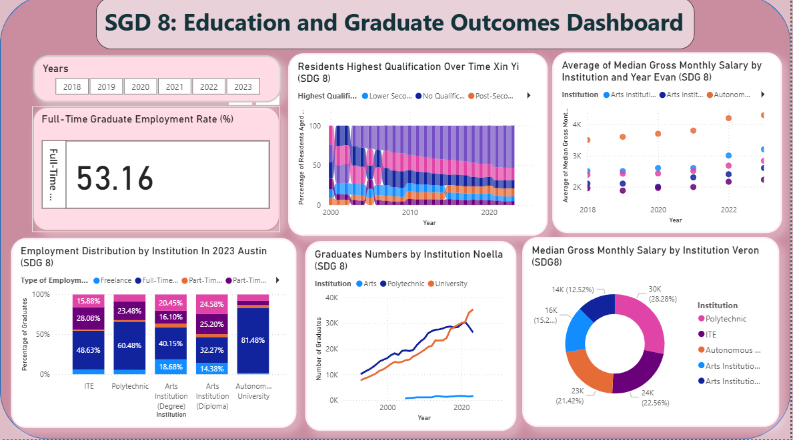

# Singapore Education & Graduate Outcomes | Power BI

A collaborative Power BI project exploring Singapore's progress in **SDG 4: Quality Education** and **SDG 8: Decent Work and Economic Growth** through educational attainment, schooling trends, graduate outcomes, and institution-level comparisons.

## Project overview

- **Tool:** Microsoft Power BI
- **Scope:** Two interactive dashboards created as an academic group project
- **Topics:** Education quality, educational attainment, graduate employment, and salary trends
- **Period covered:** Varies by dataset and visual; see chart axes and Power BI filters

## Dashboards

### SDG 4 — Education Quality and Institutional Performance

Explores students and teachers by institution, growth of the teaching workforce, educational attainment, mean years of schooling, and graduate numbers across course categories.

### SDG 8 — Education and Graduate Outcomes

Explores highest educational qualification over time, graduate employment patterns, institutional graduate counts, and median gross monthly salary comparisons.

## My contributions

This was a **group project**. The two visuals and accompanying interpretations identified as my work in the submitted report were:

1. **Mean years of schooling by gender (SDG 4):** Analysed the long-term increase in average schooling years between 1985 and 2023 and narrowing differences between male and female residents.
2. **Residents' highest qualification over time (SDG 8):** Analysed changing qualification composition among residents aged 25 and above from 2000 to 2023, highlighting a growing share with tertiary qualifications.

The broader dashboards also include visuals and insights contributed by teammates. Team-wide conclusions should not be interpreted as my individual work.

## Selected insights

- **Schooling years increased:** The submitted interpretation notes that average years of schooling rose substantially for both male and female residents between 1985 and 2023.
- **Educational attainment improved:** The submitted interpretation reports that the tertiary qualification share among residents aged 25 and above grew from approximately 24% to 52% between 2000 and 2023.
- **Comparisons are context dependent:** Graduate employment and salary levels differ by institution and year; the dashboards are descriptive, not evidence that institution type directly causes employment or pay differences.

> **Data note:** Figures above are reported from the academic dashboard and written interpretations. They have not been independently reproduced from underlying datasets in this repository. For each measure, consult the original report for denominator, data source, and filter definitions.

## How to explore

The screenshots are included for a quick portfolio preview. The source `.pbix` report and underlying data files are not included in this public-facing starter package. This means the screenshots are viewable here, but the report is not executable from this repository alone.

## Attribution and publication

Created as a collaborative academic assignment at Singapore Polytechnic. The dashboards contain teammates' visualisations; appropriate collaborator credit and permission should be confirmed before any public publication. Source dataset credits and licence information should also be added after verification.

## Possible extensions

- Document dataset links and definitions for each visual
- Add a focused dashboard page dedicated to the two individually authored analyses
- Review chart titles, truncated labels, and the use of percentages versus counts
- Include an approved `.pbix` file if source data and group permissions allow publication
